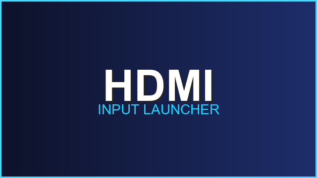
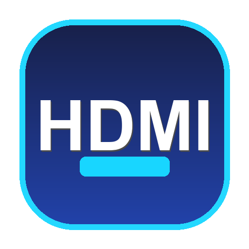

# HDMI Launcher for Allwinner Android Projectors

<p align="center">
  
</p>

<p align="center">
  
</p>

<p align="center">
  <strong>A lightweight, zero-overhead Android application acting as a direct HDMI input shortcut and dedicated home launcher for budget Android projectors powered by Allwinner SoCs.</strong>
</p>

---

## About & Purpose

Most budget Android projectors boot into a cluttered Android home screen with no native setting to default directly to the HDMI input.

**HDMI Launcher** turns your projector into a hassle-free, dedicated monitor or TV screen for PCs, PlayStation, Xbox, Nintendo Switch, or streaming boxes:
- **HDMI Launcher (Dedicated Home Launcher)**: Replaces the stock home screen. Turns on the projector, counts down 3 seconds, and jumps straight into HDMI. Pressing any remote button interrupts the countdown and lets you enter settings.
- **HDMI Shortcut (1-Click Shortcut)**: Fast shortcut placed on your dock or home screen to trigger HDMI immediately without navigating manufacturer menus.

---

## Features

- **Instant HDMI Switching**: Directly triggers the projector's native Allwinner HDMI video receiver.
- **Smart Fallback Mechanism**: Cycles through known Allwinner input receivers:
  1. `com.softwinner.awlivetv / .MainActivity` (used on Magcubic HY320, HY300, etc.)
  2. `com.softwinner.awsource / .MainActivity` (used on alternative Allwinner firmware builds)
- **Zero Overhead**: Weighs ~44 KB, zero background services, no battery or RAM drain.
- **Smooth Transition**: Employs `Theme.Translucent.NoTitleBar` to ensure a flicker-free switch into HDMI mode.
- **Android TV / Leanback Ready**: Includes 16:9 banner metadata for TV launchers and app drawers.

---

## Supported Devices & Compatibility

> [!NOTE]
> **Tested on hardware:** This project was developed and personally verified **only on the Magcubic HY320** (Allwinner H713). The author does not own other projector models.

Because budget Allwinner-powered projectors share nearly identical Android firmware and system packages (`com.softwinner.awlivetv` or `com.softwinner.awsource`), it is theoretically compatible with:
- **Magcubic**: HY300, HY300 Pro
- **Transspeed**: HY300 / HY320 variants
- **Hotack**: D035 and other H713-based smart projectors
- Other generic Android projectors running Allwinner firmware

*Community feedback and compatibility reports for other devices are warmly welcomed!*

---

## Choose Your APK

Download your preferred APK from the [Releases](https://github.com/vipluk/HDMI-Launcher/releases) section:

| APK | Mode | Ideal For |
| :--- | :--- | :--- |
| **`HDMI_Launcher.apk`** | **Home Launcher** | **Recommended.** Makes the projector act like a monitor. Auto-switches to HDMI 3 seconds after boot (interruptible with remote). |
| **`HDMI_Shortcut.apk`** | **Instant Shortcut** | 1-click icon on your existing home screen or dock to jump into HDMI immediately. |
| **`HDMI_Shortcut-5s.apk`** | **Delayed Shortcut** | Waits 5 seconds before switching. Designed for 3rd-party tools (like *Launch-On-Boot*) if your hardware needs extra time to boot decoders. |

> [!TIP]
> All versions use distinct package IDs and can be installed side-by-side without conflicts.

---

## Installation & Setup

### 1. Install the APK
Transfer the chosen APK via USB drive or ADB:
```bash
adb connect <projector-ip>:5555
adb install -r HDMI_Launcher.apk
```

### 2. Configure Boot Behavior

#### Option A: Direct Boot with HDMI Launcher (Recommended)
1. Install `HDMI_Launcher.apk`.
2. Press the **Home** button on your remote.
3. Select **HDMI Launcher** and choose **Always**.
4. Upon every power-on, the projector will show a 3-second countdown and switch directly to HDMI. Pressing any button on your remote cancels the countdown and displays shortcuts to HDMI or projector settings.

#### Option B: Using Launch-On-Boot with HDMI Shortcut (Alternative)
1. Install `HDMI_Shortcut.apk` (or `HDMI_Shortcut-5s.apk`) along with [Launch-On-Boot](https://github.com/ITVlab/Launch-On-Boot).
2. Open Launch-On-Boot and select **HDMI** as the startup application.
3. Enable "Launch on boot".

---

## Building from Source

Requirements:
- JDK 17
- Android SDK (compileSdk 34, minSdk 21)

```bash
git clone https://github.com/vipluk/HDMI-Launcher.git
cd HDMI-Launcher

# Build all release APKs
./gradlew assembleRelease
```

Generated APKs:
```text
quickboot/build/outputs/apk/release/HDMI_Launcher.apk
app/build/outputs/apk/standard/release/HDMI_Shortcut.apk
app/build/outputs/apk/delayed5s/release/HDMI_Shortcut-5s.apk
```

---

## License

This project is open source and available under the [MIT License](LICENSE).
